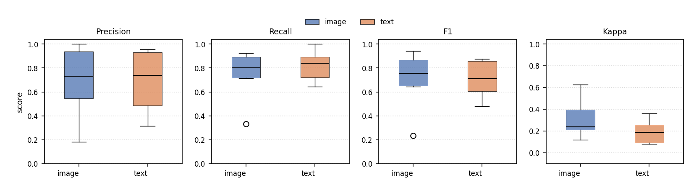

# RQ1 — LLM–human agreement and the effect of input representation

**Research question:** How well does the LLM agree with human ground truth overall, and to what extent does input representation (image vs text) affect that agreement?

**Analysis notebook:** [`rq1_overall.ipynb`](../rq1_overall.ipynb)

---

## 1. Operationalization

### 1.1 Unit of analysis and sample

| Element | Definition |
|---|---|
| **Population** | All LLM evaluation items with a matching human ground-truth row |
| **Join key** | `(Diagram_ID, Criterion, Guideline)` |
| **Diagrams included** | 6: `appwrite`, `geoserver-cloud`, `magda-io`, `research-modifiability-pattern-experiment`, `sentry`, `spryker` |
| **Diagrams excluded** | None after inner join (all 360 evaluation rows match GT) |
| **Total items** | **360** (180 image + 180 text) |
| **Models** | ChatGPT and Claude **pooled** within each representation |
| **Criteria** | accuracy, clarity, completeness, consistency, level_of_detail |

### 1.2 Representation coding

| Format | Representation |
|---|---|
| PNG | **image** |
| SVG, XML | **text** |

### 1.3 Ground truth and labels

**Binary analysis (primary for RQ1 question):**

- Source: `ground_truth_binary.csv` (from `build_ground_truth.ipynb`, with 12 boundary cases resolved).
- Positive class = **1** for precision, recall, and F1.
- LLM label: `llm_label` from `evaluations_binary.csv`.

**Ordinal analysis (complementary agreement measure):**

- Source: `ground_truth_ordinal.csv` + `evaluations_ordinal.csv`.
- Scale: **1.0–4.0** in steps of 0.5.
- Does not depend on binarization boundary decisions.

### 1.4 Metrics computed

#### Binary (pooled and by representation)

| Metric | Definition |
|---|---|
| **Simple agreement** | Fraction of items where `llm_label == gt_label` |
| **Precision** | TP / (TP + FP), positive class = 1 |
| **Recall** | TP / (TP + FN) |
| **F1** | Harmonic mean of precision and recall |
| **Macro-F1** | Mean of F1 for class 0 and class 1 |
| **Confusion matrix** | TP, FP, FN, TN counts |

#### Ordinal (pooled and by representation / criterion)

| Metric | Definition |
|---|---|
| **Quadratic weighted Cohen's κ** | Primary ordinal agreement (penalizes large score gaps) |
| **Linear weighted Cohen's κ** | Secondary ordinal agreement |
| **Spearman's ρ** | Rank correlation between GT mean score and LLM score |
| **Exact-match rate** | P(GT score = LLM score) |
| **Within-1-point rate** | P(\|GT − LLM\| ≤ 1.0) |

κ strength labels (Landis & Koch): slight < 0.20, fair 0.20–0.39, moderate 0.40–0.59, substantial 0.60–0.79, almost perfect ≥ 0.80.

### 1.5 Inferential procedures

| Analysis | Method | Robustness rule |
|---|---|---|
| CI for pooled metrics | **Bootstrap** (10,000 resamples, seed = 42) | — |
| CI per representation | Bootstrap on each representation subset | — |
| **Image − text difference** (binary) | Bootstrap CI of metric(image) − metric(text) | **Robust** if 95% CI excludes 0 |
| **Image − text difference** (κ) | Bootstrap CI of quadratic κ(image) − κ(text) | Same rule (computed ad hoc; not in export CSV) |
| Ordinal association | Spearman test (p-value from scipy) | Standard α = 0.05 |

Bootstrap resampling unit: **individual evaluation items** (not diagrams).

### 1.6 Figures (empirical, no CI on charts)

| File | Content |
|---|---|
| `figures/rq1_metrics_by_representation.png` | Thin 4-panel row: precision, recall, F1, and quadratic κ (image vs text; one value per diagram) |

### 1.7 Exported tables

- `rq1_overall_summary.csv` — pooled binary metrics
- `rq1_summary.csv` — binary metrics by representation
- `rq1_ordinal_agreement.csv` — pooled ordinal metrics
- `rq1_image_vs_text_diff.csv` — bootstrap difference (binary metrics)

---

## 2. Results

### 2.1 Pooled binary classification (n = 360)

| Metric | Value | 95% bootstrap CI |
|---|---|---|
| Simple agreement | **0.706** (70.6%) | — |
| Precision | **0.728** | [0.671, 0.785] |
| Recall | **0.797** | [0.741, 0.851] |
| F1 | **0.761** | [0.715, 0.803] |
| Macro-F1 | **0.689** | — |

**Confusion matrix (positive = 1):**

| | Pred 0 | Pred 1 |
|---|---|---|
| **Actual 0** | TN = 85 | FP = 63 |
| **Actual 1** | FN = 43 | TP = 169 |

**Interpretation:** The LLM is more **recall-oriented** than precision-oriented (recall 0.80 vs precision 0.73): it tends to agree with human **positive** labels more often than it avoids false positives.

---

### 2.2 Binary metrics by representation (n = 180 each)

| Representation | Accuracy | Precision | Recall | F1 | Macro-F1 |
|---|---|---|---|---|---|
| **image** | 0.728 | 0.752 [0.670, 0.829] | 0.802 [0.723, 0.876] | **0.776** [0.710, 0.835] | 0.714 |
| **text** | 0.683 | 0.706 [0.623, 0.786] | 0.792 [0.713, 0.868] | **0.747** [0.679, 0.807] | 0.662 |

**Confusion by representation:**

| Rep | TP | FP | FN | TN |
|---|---|---|---|---|
| image | 85 | 28 | 21 | 46 |
| text | 84 | 35 | 22 | 39 |

Image shows higher accuracy (+4.5 pp) and fewer false positives (28 vs 35).

---

### 2.3 Image vs text difference — binary metrics (bootstrap)

| Metric | image − text | 95% CI | Robust? |
|---|---|---|---|
| Precision | +0.046 | [−0.070, 0.162] | **No** |
| Recall | +0.009 | [−0.098, 0.118] | **No** |
| F1 | +0.030 | [−0.060, 0.118] | **No** |

**Conclusion (binary):** Image numerically outperforms text on all three metrics, but **none of the differences are statistically robust** at the 5% level (all CIs include 0). The RQ1 question cannot be answered affirmatively on binary F1 alone.

---

### 2.4 Pooled ordinal agreement (n = 360, scale 1–4)

| Metric | Value | 95% bootstrap CI / p |
|---|---|---|
| Quadratic weighted κ | **0.308** (fair) | [0.217, 0.393] |
| Linear weighted κ | **0.219** (fair) | [0.152, 0.287] |
| Spearman's ρ | **0.353** | p = 5.51 × 10⁻¹² |
| Exact-match rate | **26.1%** | — |
| Within-1-point rate | **87.8%** | — |

**Interpretation:** Chance-corrected ordinal agreement is **fair**. Rank correlation is highly significant, but exact score matches are rare (26%); most agreement is approximate (within one scale point).

The gap between high binary F1 (~0.76) and moderate κ (~0.31) is expected: they measure different things (binarized pass/fail vs graded 1–4 scale with chance correction).

---

### 2.5 Ordinal κ by representation (bootstrap CI)

| Group | Quadratic κ | 95% CI |
|---|---|---|
| **Overall (pooled)** | 0.308 | [0.217, 0.393] |
| **image** | **0.387** | [0.258, 0.507] |
| **text** | **0.225** | [0.094, 0.349] |

**Image − text κ difference (bootstrap, ad hoc):**

| Δκ (image − text) | 95% CI | Robust? |
|---|---|---|
| +0.162 | [−0.020, 0.337] | **No** (CI includes 0) |

Descriptively, image shows substantially higher ordinal agreement; the bootstrap CI of the difference **barely includes zero** at the lower bound (−0.020), so the evidence is **suggestive but not conclusive** under the pre-specified robustness rule.

---

### 2.6 Ordinal κ by criterion (bootstrap CI; chart in RQ2)

| Criterion | Quadratic κ | 95% CI |
|---|---|---|
| accuracy | 0.257 | [0.076, 0.438] |
| clarity | 0.336 | [0.156, 0.491] |
| completeness | **0.396** | [0.163, 0.631] |
| consistency | 0.341 | [0.138, 0.508] |
| level_of_detail | 0.259 | [0.121, 0.389] |

Completeness shows the highest ordinal agreement; accuracy and level_of_detail the lowest (wide CIs due to smaller effective samples per criterion).

---

### 2.7 Synthesis for RQ1

| Evidence line | Direction | Significant / robust? |
|---|---|---|
| Binary F1 (image vs text) | Image +0.030 F1 | No |
| Binary precision / recall | Image slightly higher | No |
| Ordinal κ (image vs text) | Image +0.162 κ | No (borderline) |
| Pooled performance | F1 = 0.76, κ = 0.31 | — |

**Overall answer:** There is a **consistent descriptive advantage for image** across binary and ordinal metrics, but **inferential tests do not support a robust overall representation effect** on agreement with human ground truth. Expert preference for image-based reasoning (RQ3) is significant, but automatic GT agreement (RQ1) does not reach the same level of statistical certainty—possibly because GT agreement and expert pairwise preference measure different constructs.

---

## 3. Figures

---

## 4. Data files referenced

| File | Role |
|---|---|
| `../llm-evaluations/evaluations_binary.csv` | LLM binary labels |
| `../llm-evaluations/evaluations_ordinal.csv` | LLM ordinal scores |
| `../ground-truth/ground_truth_binary.csv` | Human binary GT |
| `../ground-truth/ground_truth_ordinal.csv` | Human ordinal GT |
