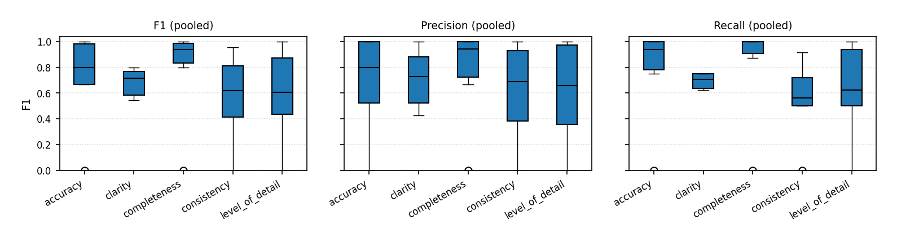
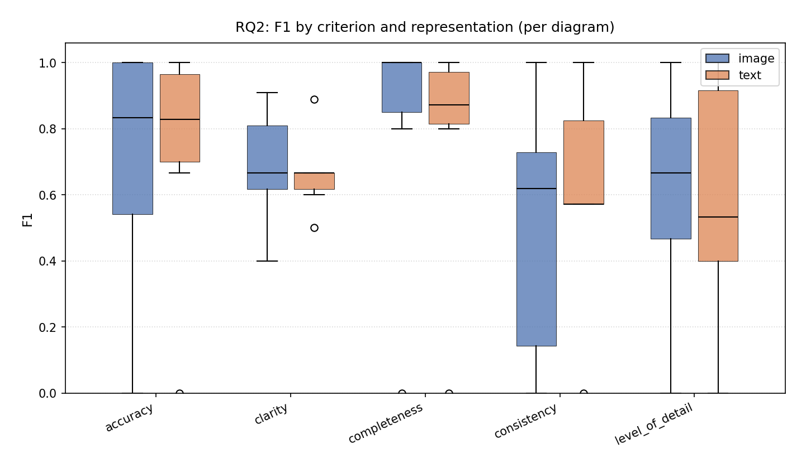
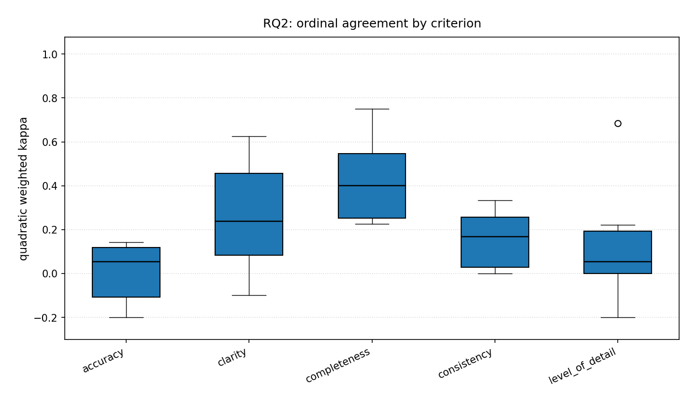

# RQ2 — LLM–human agreement by criterion and the effect of representation

**Research question:** Which evaluation criteria show stronger LLM–human agreement, and does input representation (image vs text) alter agreement within each criterion?

**Analysis notebook:** [`rq2_per_criterion.ipynb`](../rq2_per_criterion.ipynb)

---

## 1. Operationalization

### 1.1 Design

Same data pipeline as RQ1:

- Join `evaluations_binary.csv` with `ground_truth_binary.csv` on `(Diagram_ID, Criterion, Guideline)`.
- **360 items** total; **6 diagrams** × 5 criteria × 2 representations × 2 models (pooled).
- Representation: PNG → image; SVG/XML → text.
- Positive class = 1 for precision, recall, F1.

### 1.2 Analysis layers

| Layer | Grouping | Purpose |
|---|---|---|
| **A. Pooled by criterion** | All representations and models combined | Baseline difficulty per criterion |
| **B. Representation × criterion** | 10 cells (2 × 5) | Where image vs text diverges |
| **C. Image − text per criterion** | Bootstrap diff within each criterion | Robust advantage test |
| **D. Ordinal κ by criterion** | Quadratic κ, one value per diagram | Graded agreement per criterion |

### 1.3 Metrics (each with bootstrap 95% CI)

- **Accuracy** (simple agreement)
- **Precision**, **Recall**, **F1** (positive class = 1)
- **Quadratic weighted Cohen's κ** (ordinal; per diagram, then boxplot)

Bootstrap: 10,000 resamples, seed = 42.  
**Robust advantage:** 95% CI of `metric(image) − metric(text)` excludes 0.

### 1.4 Sample sizes

**Pooled by criterion:**

| Criterion | n |
|---|---|
| accuracy | 48 |
| clarity | 96 |
| completeness | 72 |
| consistency | 72 |
| level_of_detail | 72 |

**Per (representation, criterion) cell:** n = 24 (accuracy) or 36–48 (other criteria), depending on guideline count.

### 1.5 Figures (empirical boxplots, no CI on charts)

| File | Content |
|---|---|
| `figures/rq2_metrics_by_criterion_pooled.png` | Thin 3-panel row: F1, precision, recall by criterion (pooled, one value per diagram) |
| `figures/rq2_f1_by_criterion.png` | F1: image vs text at each criterion |
| `figures/rq2_kappa_by_criterion.png` | Ordinal κ by criterion |

### 1.6 Exported tables

- `rq2_f1_per_criterion_aggregated.csv`
- `rq2_per_criterion.csv`
- `rq2_image_vs_text_by_criterion.csv`

---

## 2. Results

### 2.1 Pooled performance by criterion (all representations)

| Criterion | n | Accuracy | Precision | Recall | **F1** |
|---|---|---|---|---|---|
| **completeness** | 72 | 0.819 | 0.765 [0.644, 0.875] | 0.975 [0.918, 1.000] | **0.857** [0.773, 0.926] |
| **accuracy** | 48 | 0.729 | 0.732 [0.595, 0.860] | 0.938 [0.844, 1.000] | **0.822** [0.716, 0.909] |
| **level_of_detail** | 72 | 0.694 | 0.705 [0.565, 0.837] | 0.775 [0.641, 0.897] | **0.738** [0.623, 0.835] |
| **consistency** | 72 | 0.653 | 0.721 [0.579, 0.850] | 0.705 [0.565, 0.837] | **0.713** [0.593, 0.809] |
| **clarity** | 96 | 0.656 | 0.717 [0.591, 0.833] | 0.679 [0.552, 0.800] | **0.697** [0.588, 0.787] |

**Ranking by pooled F1:** completeness > accuracy > level_of_detail > consistency > clarity.

Completeness and accuracy show very high recall (≥ 0.94), indicating the LLM rarely misses human-positive labels on these criteria. Clarity is the hardest criterion overall (lowest F1 and recall).

---

### 2.2 Representation × criterion — full metric table

#### F1 (with 95% bootstrap CI)

| Criterion | Image F1 | Image CI | Text F1 | Text CI |
|---|---|---|---|---|
| accuracy | **0.857** | [0.710, 0.970] | 0.789 | [0.625, 0.909] |
| clarity | **0.727** | [0.571, 0.844] | 0.667 | [0.500, 0.800] |
| completeness | **0.870** | [0.750, 0.958] | 0.844 | [0.711, 0.943] |
| consistency | 0.700 | [0.514, 0.844] | **0.723** | [0.558, 0.852] |
| level_of_detail | **0.744** | [0.579, 0.875] | 0.732 | [0.556, 0.868] |

#### Precision

| Criterion | Image | Text |
|---|---|---|
| accuracy | 0.789 | 0.682 |
| clarity | 0.741 | 0.692 |
| completeness | 0.769 | 0.760 |
| consistency | 0.778 | 0.680 |
| level_of_detail | 0.696 | 0.714 |

#### Recall

| Criterion | Image | Text |
|---|---|---|
| accuracy | 0.938 | 0.938 |
| clarity | 0.714 | 0.643 |
| completeness | 1.000 | 0.950 |
| consistency | 0.636 | 0.773 |
| level_of_detail | 0.800 | 0.750 |

#### Accuracy (simple agreement)

| Criterion | Image | Text |
|---|---|---|
| accuracy | 0.792 | 0.667 |
| clarity | 0.688 | 0.625 |
| completeness | 0.833 | 0.806 |
| consistency | 0.667 | 0.639 |
| level_of_detail | 0.694 | 0.694 |

**Notable patterns:**

- **Image wins on F1** for 4/5 criteria; **text wins only on consistency** (F1 0.723 vs 0.700).
- **Accuracy criterion:** largest image advantage (F1 +0.068, precision +0.107).
- **Consistency:** text has higher recall (+0.136) but lower precision; net F1 slightly favors text.
- **Level of detail:** essentially tied (F1 diff +0.012).

---

### 2.3 Image − text advantage tests (bootstrap 95% CI)

#### F1 difference (image − text)

| Criterion | ΔF1 | 95% CI | Robust? |
|---|---|---|---|
| accuracy | +0.068 | [−0.130, 0.269] | No |
| clarity | +0.061 | [−0.143, 0.263] | No |
| completeness | +0.025 | [−0.130, 0.187] | No |
| consistency | −0.023 | [−0.250, 0.201] | No |
| level_of_detail | +0.012 | [−0.202, 0.237] | No |

#### Precision difference (image − text)

| Criterion | ΔPrecision | 95% CI | Robust? |
|---|---|---|---|
| accuracy | +0.108 | [−0.164, 0.376] | No |
| clarity | +0.048 | [−0.198, 0.293] | No |
| completeness | +0.009 | [−0.221, 0.243] | No |
| consistency | +0.098 | [−0.178, 0.361] | No |
| level_of_detail | −0.019 | [−0.286, 0.259] | No |

#### Recall difference (image − text)

| Criterion | ΔRecall | 95% CI | Robust? |
|---|---|---|---|
| accuracy | 0.000 | [−0.170, 0.176] | No |
| clarity | +0.071 | [−0.175, 0.310] | No |
| completeness | +0.050 | [0.000, 0.167] | No* |
| consistency | −0.136 | [−0.400, 0.136] | No |
| level_of_detail | +0.050 | [−0.213, 0.318] | No |

\*Completeness recall lower bound touches 0 exactly; CI still includes 0 → not robust.

**Conclusion:** **No criterion shows a robust image-vs-text advantage** on F1, precision, or recall. Accuracy and clarity show the largest *descriptive* image advantages but with wide CIs.

---

### 2.4 Ordinal agreement by criterion (quadratic κ)

| Criterion | κ (pooled bootstrap) | 95% CI | Empirical spread (diagram boxplot) |
|---|---|---|---|
| completeness | **0.396** | [0.163, 0.631] | Highest median κ |
| consistency | 0.341 | [0.138, 0.508] | — |
| clarity | 0.336 | [0.156, 0.491] | — |
| level_of_detail | 0.259 | [0.121, 0.389] | — |
| accuracy | 0.257 | [0.076, 0.438] | Widest CI (smallest n per diagram) |

Ordinal and binary rankings partially align: **completeness** is strongest on both F1 and κ; **accuracy** has high binary F1 but lower κ (experts use finer-grained scores that the LLM matches less exactly).

---

### 2.5 Cross-criterion comparison of representation effect

| Criterion | Best rep (F1) | ΔF1 | Direction | Robust? |
|---|---|---|---|---|
| accuracy | image | +0.068 | image | No |
| clarity | image | +0.061 | image | No |
| completeness | image | +0.025 | image | No |
| consistency | text | −0.023 | text | No |
| level_of_detail | image | +0.012 | image | No |

**Pattern:** Image advantage is **descriptively consistent** except for consistency. No single criterion drives the overall RQ1 effect; advantages are small and uncertain everywhere.

---

### 2.6 Synthesis for RQ2

1. **Criterion difficulty varies:** completeness and accuracy are easiest (high F1/recall); clarity is hardest.
2. **Representation effects are criterion-specific but small:** image leads on 4/5 criteria; text slightly on consistency.
3. **No robust per-criterion representation effect** survives bootstrap testing — consistent with RQ1.
4. **Ordinal κ by criterion** (RQ2 chart) complements binary F1: completeness shows best graded agreement; accuracy binary F1 is high despite moderate κ.

**Answer to RQ2:** There is **no criterion for which image or text can be declared significantly better** against human GT at α = 0.05 using bootstrap CI exclusion. Descriptively, **accuracy and clarity** favor image most; **consistency** slightly favors text.

---

## 3. Figures

---

## 4. Data files referenced

| File | Role |
|---|---|
| `../llm-evaluations/evaluations_binary.csv` | LLM binary labels |
| `../llm-evaluations/evaluations_ordinal.csv` | LLM ordinal scores (κ chart) |
| `../ground-truth/ground_truth_binary.csv` | Human binary GT |
| `../ground-truth/ground_truth_ordinal.csv` | Human ordinal GT |
