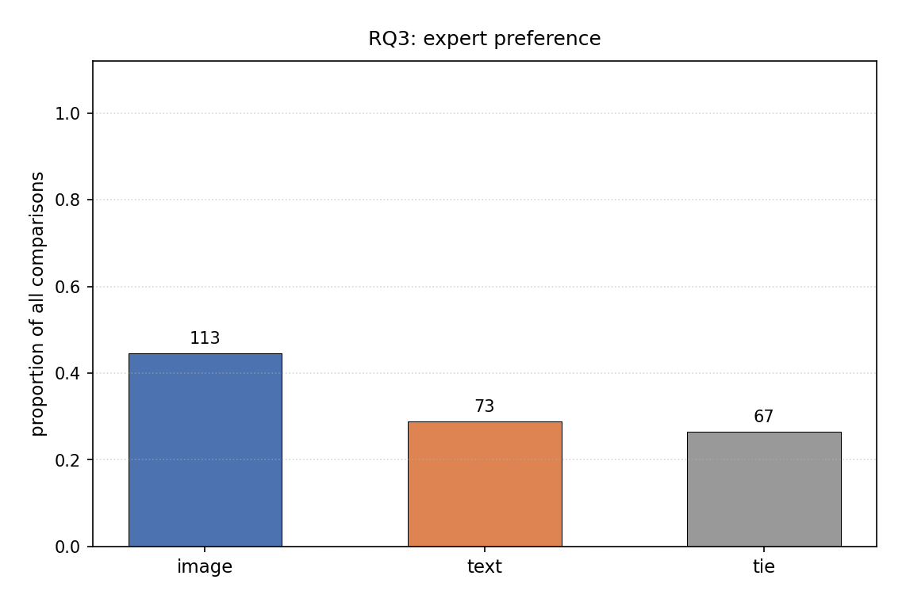
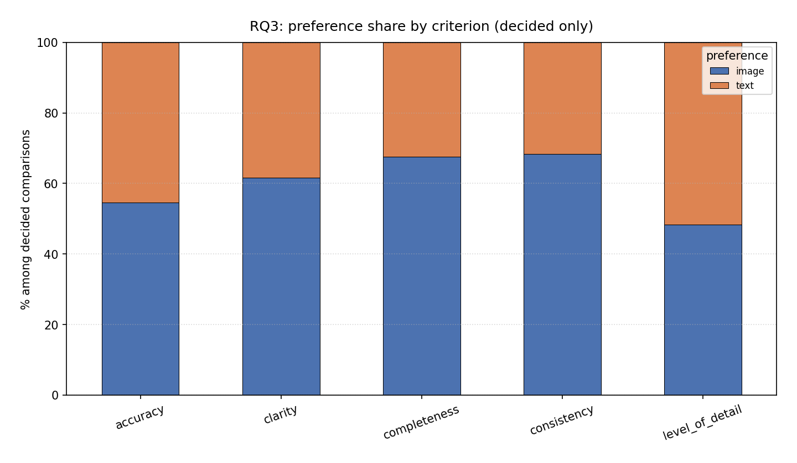

# RQ3 — Expert preference for LLM reasoning (image vs text)

**Research question:** Do experts prefer the LLM's reasoning when the input is an image (PNG) or text (SVG/XML)?

**Analysis notebook:** [`rq3_preference.ipynb`](../rq3_preference.ipynb)

**Data source:** [`llm-assesment-v2 - pairwise_preferences.csv`](../../llm-assesment-v2%20-%20pairwise_preferences.csv)

---

## 1. Operationalization

### 1.1 Unit of analysis

Each row is one **pairwise comparison** in which an expert evaluated two LLM responses (Response A vs Response B) for the same `(Diagram_ID, Criterion, Guideline)` and selected a preferred reasoning or a tie.

| Element | Value |
|---|---|
| **Total comparisons** | **253** |
| **Expert task** | Choose which LLM reasoning is better (or tie) |
| **Compared formats** | PNG (image) vs SVG/XML (text) in counterbalanced pairs |

### 1.2 Preference coding

| `Preferred_Format` | Coded preference |
|---|---|
| PNG | **image** |
| SVG, XML | **text** |
| Tie | **tie** |

Ties are **excluded** from inferential tests comparing image vs text, but reported descriptively.

### 1.3 Analyses performed

| # | Analysis | Method | Purpose |
|---|---|---|---|
| 1 | **Overall counts** | Descriptive | image / text / tie frequencies |
| 2 | **Tie rate** | Proportion of all comparisons | Measure expert indecision |
| 3 | **Headline significance test** | **Chi-square goodness-of-fit** (df = 1) | H₀: image = text = 50/50 among **decided** comparisons |
| 4 | **Image share (decided)** | Point estimate + **Wilson 95% CI** | Magnitude of preference (descriptive, not a test) |
| 5 | **Preference × Criterion** | **Chi-square test of independence** | Does preference depend on criterion? |
| 6 | **Preference × source model** | Chi-square test of independence | Does preference depend on ChatGPT vs Claude? |
| 7 | **Breakdown by criterion** | Counts + normalized shares + Wilson CI per criterion | Where preference concentrates |
| 8 | **Breakdown by diagram** | Counts (image / text / tie) | Diagram-level balance |
| 9 | **Qualitative export** | Full justifications in CSV | Assistive scaffold for thematic review |

**Significance level:** α = 0.05.

**Note:** Wilson CI estimates the **proportion of image choices among decided comparisons**; it is a descriptive interval, not equivalent to the chi-square test.

### 1.4 Figures (no CI on charts)

| File | Content |
|---|---|
| `figures/rq3_overall_preference.png` | Bar chart: image / text / tie as proportion of all 253 comparisons |
| `figures/rq3_preference_breakdowns.png` | 100% stacked bar by criterion (decided only) |

### 1.5 Exported tables

- `rq3_summary.csv` — headline statistics and test results
- `rq3_preference_by_criterion.csv` — per-criterion image share with Wilson CI
- `rq3_justifications.csv` — 72 rows with expert free-text justifications (where recorded)

---

## 2. Results

### 2.1 Overall preference distribution (n = 253)

| Preference | Count | % of all comparisons |
|---|---|---|
| **image** | **113** | **44.7%** |
| **text** | 73 | 28.9% |
| **tie** | 67 | **26.5%** |

**Raw format mapping:**

| Preferred_Format | Count |
|---|---|
| PNG | 113 |
| SVG | 41 |
| XML | 32 |
| Tie | 67 |

**Tie rate:** 26.5% — roughly one in four comparisons ended without a clear winner, indicating substantial expert uncertainty or equivalent quality.

---

### 2.2 Decided comparisons only (ties excluded, n = 186)

| Group | Count | Share |
|---|---|---|
| image | 113 | **60.8%** |
| text | 73 | 39.2% |

**Wilson 95% CI for image share (among decided):** **60.8%** [53.6%, 67.5%]

The interval excludes 50%, consistent with the chi-square result below.

---

### 2.3 Headline test — chi-square goodness-of-fit

**H₀:** Among decided comparisons, experts choose image and text with equal probability (50/50).

| | Observed | Expected (H₀) |
|---|---|---|
| image | 113 | 93.0 |
| text | 73 | 93.0 |

| Statistic | Value |
|---|---|
| χ² | **8.60** |
| df | 1 |
| p-value | **0.0034** |
| Min expected count | 93.0 (≥ 5 ✓) |

**Result:** **Significant at α = 0.05.** Experts **prefer image-based LLM reasoning** over text-based reasoning in pairwise comparisons.

This is the primary inferential finding for RQ3.

---

### 2.4 Preference × criterion (chi-square independence)

**Contingency table (decided only):**

| Criterion | image | text | n decided | image % |
|---|---|---|---|---|
| accuracy | 18 | 15 | 33 | 54.5% |
| clarity | 29 | 18 | 47 | **61.7%** |
| completeness | 23 | 11 | 34 | **67.6%** |
| consistency | 28 | 13 | 41 | **68.3%** |
| level_of_detail | 15 | 16 | 31 | 48.4% |

| Statistic | Value |
|---|---|
| χ² | 4.19 |
| df | 4 |
| p-value | **0.380** |
| Min expected | 12.17 |

**Result:** **Not significant.** Preference for image is **not statistically dependent** on criterion — the image advantage appears **broad rather than driven by a single criterion**.

**Wilson 95% CI for image share by criterion:**

| Criterion | image share | 95% CI |
|---|---|---|
| accuracy | 54.5% | [38.0%, 70.2%] |
| clarity | 61.7% | [47.4%, 74.2%] |
| completeness | 67.6% | [50.8%, 80.9%] |
| consistency | 68.3% | [53.0%, 80.4%] |
| level_of_detail | 48.4% | [32.0%, 65.2%] |

All per-criterion CIs **include 50%** except possibly consistency and completeness point estimates above 50% with lower bounds above 50% for completeness (50.8%) and consistency (53.0%) — but the **omnibus** chi-square does not reject independence, so per-criterion differences should be interpreted cautiously (multiple comparisons, smaller n).

**Descriptive note:** `level_of_detail` is the only criterion where text is numerically preferred (16 vs 15); all others favor image.

---

### 2.5 Preference × source model (chi-square independence)

**Contingency table (decided only):**

| Source model | image | text | n |
|---|---|---|---|
| ChatGPT | 70 | 53 | 123 |
| Claude | 43 | 20 | 63 |

| Statistic | Value |
|---|---|
| χ² | 1.80 |
| df | 1 |
| p-value | **0.180** |
| Min expected | 24.73 |

**Result:** **Not significant.** Image preference does not differ reliably between ChatGPT and Claude.

**Descriptive shares (decided):**

| Model | image share |
|---|---|
| ChatGPT | 70/123 = **56.9%** |
| Claude | 43/63 = **68.3%** |

Claude comparisons show a larger image share descriptively, but the sample is smaller and the test is non-significant.

---

### 2.6 Tie rate by criterion

| Criterion | Ties | Total comparisons* | Tie rate |
|---|---|---|---|
| accuracy | 10 | 43 | 23.3% |
| clarity | 14 | 61 | 23.0% |
| completeness | 17 | 51 | 33.3% |
| consistency | 9 | 50 | 18.0% |
| level_of_detail | 17 | 48 | 35.4% |

\*Total = image + text + tie per criterion from raw data.

**Highest tie rates:** level_of_detail (35.4%) and completeness (33.3%) — experts more often saw equivalent reasoning on these criteria.

---

### 2.7 Preference by diagram

| Diagram | image | text | tie | n |
|---|---|---|---|---|
| magda-io | **35** | 22 | 17 | 74 |
| research-modifiability-pattern-experiment | 22 | 8 | 5 | 35 |
| geoserver-cloud | 18 | 10 | 4 | 32 |
| appwrite | 11 | 9 | 22 | 42 |
| sentry | 15 | 10 | 6 | 31 |
| spryker | 12 | 14 | 13 | 39 |

**Observations:**

- **magda-io** contributes the most comparisons (74) and a strong image lead (35 vs 22).
- **appwrite** has the highest tie rate (22/42 = 52%) — experts often found responses equivalent.
- **spryker** is the only diagram with more text than image preferences (14 vs 12), but with 13 ties.

Diagram counts are **not chi-square tested** in the notebook (diagram is partially confounded with comparison count); reported for descriptive completeness.

---

### 2.8 Qualitative justifications (exploratory)

`rq3_justifications.csv` contains **72** free-text justifications (not all 253 comparisons include text).

**Recurring themes in image-preferred justifications:**

- Better detection of **visual mismatches** (e.g., OpenSearch vs ElasticSearch labels in diagrams).
- More **critical** or **detailed** reading of diagram elements, symbols, and notation.
- Clearer identification of **missing components** visible in the figure but not in text.

**Recurring themes in text-preferred justifications:**

- Better **reading flow** or **language clarity** when the source is structured text (SVG/XML).
- More appropriate scoring when the **textual description** is the primary reference.
- Catching **hallucinations** or **assumptions** in image-based responses.

**Recurring themes in ties:**

- Both responses identify the **same limitations** of the diagram.
- Neither response is clearly superior; **equivalent issues** noted.

These themes are **not formally coded** (no thematic analysis pipeline); they support interpretation of the quantitative results.

---

### 2.9 Relationship to RQ1 and RQ2

| Finding | RQ3 (expert preference) | RQ1/RQ2 (GT agreement) |
|---|---|---|
| Overall direction | **Image preferred** (60.8%, p = 0.003) | Image slightly better descriptively |
| Significance | **Yes** (chi-square GoF) | **No** (bootstrap CI includes 0) |
| Construct | Which reasoning experts **prefer** | How well LLM **matches human GT labels** |

Experts significantly prefer image-based reasoning in pairwise evaluation, but that preference **does not translate into a robust advantage** on automatic agreement with ground-truth labels. Possible explanations:

1. **Preference ≠ correctness** — experts may value detail/critical tone in image responses even when scores diverge from GT.
2. **GT measures label agreement**, not reasoning quality per se.
3. **High tie rate (26.5%)** in RQ3 vs forced binary GT in RQ1/RQ2.

---

### 2.10 Synthesis for RQ3

| Question | Answer |
|---|---|
| Do experts prefer image or text? | **Image** (60.8% of decided, p = 0.003) |
| Is preference criterion-specific? | **No significant dependence** (p = 0.38) |
| Does model matter? | **No significant dependence** (p = 0.18) |
| How common are ties? | **26.5%** overall; highest for level_of_detail and completeness |
| Magnitude | Wilson CI [53.6%, 67.5%] for image share among decided |

**Primary conclusion:** Experts **significantly prefer image-based LLM reasoning** in head-to-head comparisons. The effect appears **general across criteria** rather than localized, and is **independent of source model** in this sample.

---

## 3. Figures

---

## 4. Summary statistics file (`rq3_summary.csv`)

| metric | value |
|---|---|
| n_total | 253 |
| n_image | 113 |
| n_text | 73 |
| n_tie | 67 |
| image_share_decided | 0.608 |
| image_share_ci_lo | 0.536 |
| image_share_ci_hi | 0.675 |
| gof_chi2 | 8.602 |
| gof_p_value | 0.003358 |
| indep_criterion_chi2 | 4.194 |
| indep_criterion_p | 0.380 |
| indep_model_chi2 | 1.798 |
| indep_model_p | 0.180 |
